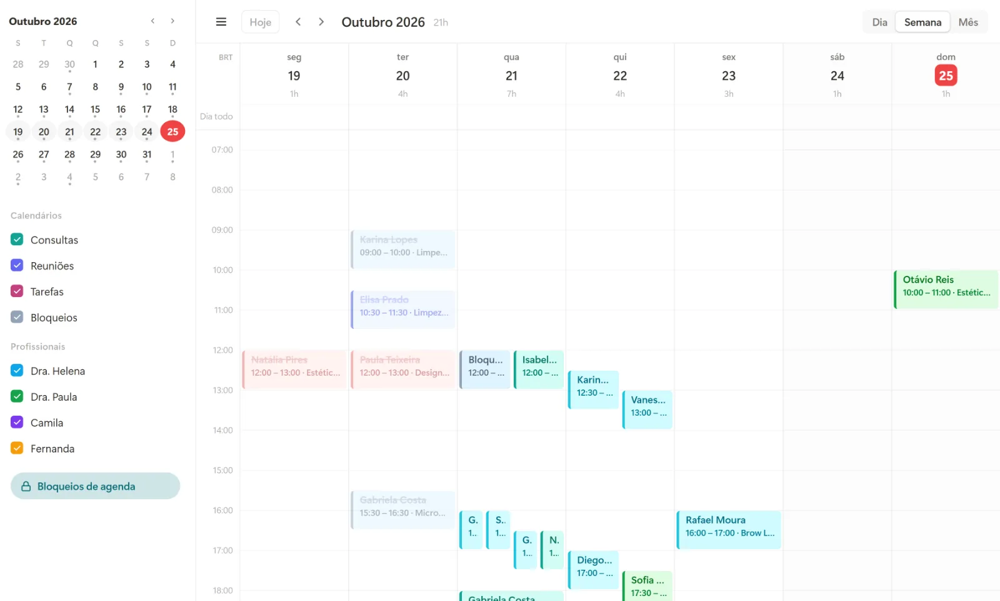

Marcar uma consulta ainda é, em muitas clínicas, uma troca longa de mensagens: o paciente pergunta se tem horário, a recepção consulta a agenda, oferece dois ou três, o paciente demora para responder e, quando responde, o horário já foi.

O agendamento online encurta esse caminho. O paciente vê os horários livres e escolhe o que serve, a qualquer hora. A seguir, como funciona na prática e o que observar antes de implantar.

## Como funciona o agendamento online

Existem três portas de entrada, e o ideal é que todas caiam na mesma agenda:

- **Pelo site:** um calendário com os horários livres de cada profissional e serviço.
- **Pelo WhatsApp:** o atendimento automático oferece os horários na própria conversa, com botões.
- **Pela recepção:** a equipe continua marcando por telefone ou presencialmente, na mesma agenda.

O ponto central é a agenda única. Se o site, o WhatsApp e a recepção olharem para agendas diferentes, os horários duplicados aparecem em poucos dias.

## O que muda na recepção

A recepção não perde importância, ela muda de função. Sai o trabalho repetitivo de oferecer horário e entra o cuidado com quem está na clínica e com os casos que pedem atenção:

1. **Menos mensagens para marcar.** O vai e vem de "tem horário na quinta?" diminui bastante.
2. **Agendamentos fora do horário comercial.** Muita gente marca à noite e no fim de semana, quando a clínica está fechada.
3. **Informação completa desde o início.** O paciente já informa nome, telefone, convênio e motivo da consulta no momento do agendamento.

[[cta]]

## Cuidados para a agenda não virar bagunça

O agendamento online funciona bem quando algumas regras ficam claras desde o início:

- **Tempo de cada serviço.** Uma primeira consulta e um retorno raramente têm a mesma duração. Cada serviço precisa do seu tempo.
- **Intervalos e bloqueios.** Almoço, reuniões e horários reservados para encaixes não aparecem para o paciente.
- **Antecedência mínima.** Evite que alguém marque para daqui a 30 minutos sem a equipe saber.
- **Confirmação automática.** Todo agendamento online deve receber a confirmação no WhatsApp e o lembrete na véspera.
- **Sincronização com o Google Agenda.** Assim o profissional vê os compromissos no celular, junto com a vida fora da clínica.

## E os convênios e serviços que pedem triagem?

Nem todo atendimento deve ser marcado sem conversa. Procedimentos que dependem de avaliação, convênios com regras próprias ou casos de urgência podem seguir para a recepção antes de virar horário. O atendimento automático faz as perguntas iniciais e encaminha o caso para uma pessoa quando for preciso.

## Como medir se valeu a pena

- quantos agendamentos chegam pelo site e pelo WhatsApp;
- quantos acontecem fora do horário comercial;
- a taxa de faltas dos agendamentos online, comparada com os marcados pela recepção;
- o tempo que a recepção ganhou no dia.

## Perguntas frequentes

### O paciente precisa baixar algum aplicativo para agendar?

Não. Ele agenda pelo site, no navegador, ou pelo WhatsApp que já usa no dia a dia.

### Dá para limitar quais serviços aparecem no agendamento online?

Sim. Cada serviço pode aparecer ou não para o paciente, e os que precisam de avaliação seguem para a recepção.

### O agendamento online funciona com mais de um profissional?

Sim. Cada profissional tem a sua agenda, com seus serviços e horários, e o paciente escolhe com quem quer marcar ou o primeiro horário livre.

### E se o paciente marcar e não aparecer?

Ele recebe a confirmação na véspera, e quem não confirma fica em destaque para a recepção. Isso reduz as faltas também nos agendamentos online.
