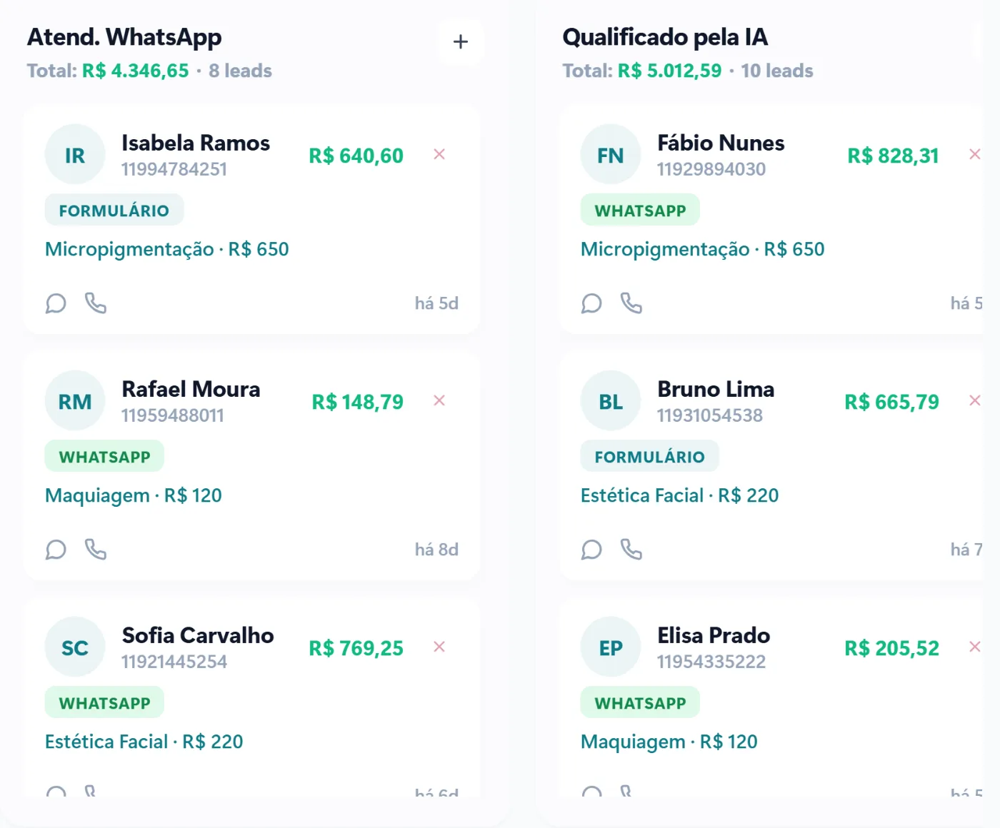

Se o WhatsApp é o principal canal de contato da sua empresa, você conhece a cena: mensagens chegando fora do horário, gente perguntando a mesma coisa vinte vezes por dia, cliente que some porque ninguém respondeu a tempo. Automatizar o WhatsApp resolve boa parte disso, desde que seja feito do jeito certo.

Este guia mostra o que vale automatizar, o que deve continuar nas mãos de uma pessoa e como começar sem colocar o número da empresa em risco.

## O que é automação de WhatsApp, na prática

Automação de WhatsApp é fazer o sistema cuidar das partes repetitivas da conversa: dar boas-vindas, responder perguntas frequentes, coletar dados, marcar horário, mandar lembrete e passar o contato para a pessoa certa da equipe.

Ela não substitui o atendimento humano. Ela tira da sua equipe o trabalho que não precisa de uma pessoa, para que ela tenha tempo de cuidar do que precisa.

Hoje existem três níveis:

- **Respostas automáticas simples:** mensagem de ausência e saudação. É o que o WhatsApp Business gratuito já oferece.
- **Fluxos com botões:** o cliente escolhe uma opção ("Quero agendar", "Ver preços", "Falar com alguém") e a conversa segue um caminho definido.
- **Atendimento com inteligência artificial:** a IA entende a pergunta escrita do jeito que o cliente escreveu, responde com as informações da sua empresa e chama uma pessoa quando o assunto foge do roteiro.

## O que vale a pena automatizar

Comece pelo que mais toma tempo da equipe e menos exige julgamento. Na maioria das empresas, a lista é parecida:

1. **Primeiro contato fora do horário.** Quem escreve às 22h recebe resposta na hora, com as informações básicas e a opção de já deixar o pedido ou marcar um horário.
2. **Perguntas frequentes.** Endereço, horário de funcionamento, formas de pagamento, se atende convênio, prazo de entrega.
3. **Agendamento.** O cliente escolhe o dia e o horário livres sem ninguém precisar consultar a agenda e responder.
4. **Lembretes.** Confirmação de consulta no dia anterior, aviso de pedido saindo, lembrete de pagamento.
5. **Qualificação do contato.** Antes de chegar ao vendedor, o sistema já pergunta o que a pessoa procura e registra a resposta.
6. **Pós-venda.** Pedido de avaliação, pesquisa de satisfação, aviso de retorno ou revisão.

[[cta]]

## O que deve continuar com uma pessoa

A automação que irrita o cliente é a que prende ele em um robô quando ele precisa de gente. Deixe com pessoas:

- negociações de preço e propostas fora do padrão;
- reclamações e clientes irritados;
- assuntos delicados, como saúde, dinheiro e questões jurídicas;
- qualquer conversa em que o cliente peça para falar com alguém.

A regra que usamos na VCA é simples: o cliente sempre tem um caminho rápido para chegar a uma pessoa, e essa pessoa recebe a conversa com o histórico completo, sem precisar perguntar tudo de novo.

## API oficial ou ferramenta "pirata"?

Este é o ponto que mais custa caro para quem erra. Existem ferramentas que automatizam o WhatsApp por meio de extensões de navegador ou aplicativos não autorizados. Elas parecem baratas e fáceis, mas violam os termos do WhatsApp e podem levar ao **bloqueio do número da empresa**, junto com todo o histórico de conversas.

O caminho seguro é a **API oficial do WhatsApp Business**, da Meta. Com ela você tem:

- número verificado, com o nome da empresa;
- vários atendentes no mesmo número;
- botões e listas de opções nas mensagens;
- integração com CRM, agenda e sistema de vendas;
- regras claras de envio, sem risco de bloqueio por uso indevido.

Uma regra importante da API oficial: você pode responder livremente durante 24 horas depois da última mensagem do cliente. Fora dessa janela, só é possível enviar modelos de mensagem aprovados pela Meta, que podem ter custo. Por isso, lembretes e avisos precisam ser planejados com antecedência.

## Como começar sem travar o atendimento

Uma automação bem feita entra no ar em etapas, não de uma vez:

1. **Mapeie as conversas.** Leia as últimas semanas de mensagens e anote as dez perguntas que mais se repetem e onde o atendimento mais demora.
2. **Defina o caminho de cada tipo de contato.** Quem quer orçamento vai para um lado, quem quer agendar vai para outro, quem tem problema vai direto para uma pessoa.
3. **Escreva as respostas com a voz da empresa.** Automação não precisa soar como robô. Mensagens curtas, claras e educadas funcionam melhor.
4. **Ligue ao CRM.** Cada contato que chega vira um registro, com a etapa em que está. Assim nenhum cliente fica esquecido em uma conversa antiga.
5. **Acompanhe e ajuste.** Nas primeiras semanas, revise as conversas em que o cliente desistiu ou pediu uma pessoa. É ali que estão as melhorias.

## Quanto tempo leva para dar resultado

O ganho mais imediato é o tempo de resposta: o cliente que escrevia e esperava horas passa a ser atendido na hora. Isso aparece logo nas primeiras semanas. Os ganhos de organização, como saber quantos contatos viraram clientes e onde eles travam, ficam claros entre o segundo e o terceiro mês, quando já existe histórico para comparar.

## Perguntas frequentes

### Posso automatizar o WhatsApp Business gratuito?

Só em parte. O aplicativo gratuito permite mensagem de ausência, saudação e respostas rápidas. Para fluxos com botões, atendimento com IA, vários atendentes e integração com sistema, é preciso usar a API oficial do WhatsApp Business.

### A automação deixa o atendimento frio?

Não, se for bem planejada. Mensagens escritas com a voz da empresa e um caminho fácil para falar com uma pessoa deixam o atendimento mais rápido sem perder a proximidade.

### Vou perder o meu número atual?

Não precisa. É possível levar o número que a empresa já usa para a API oficial. O que muda é que as conversas passam a ser atendidas pelo sistema, e não mais pelo aplicativo no celular.

### Funciona para empresas pequenas?

Sim. Empresas pequenas costumam ser as que mais ganham, porque normalmente uma ou duas pessoas fazem o atendimento inteiro e qualquer hora economizada faz diferença.
