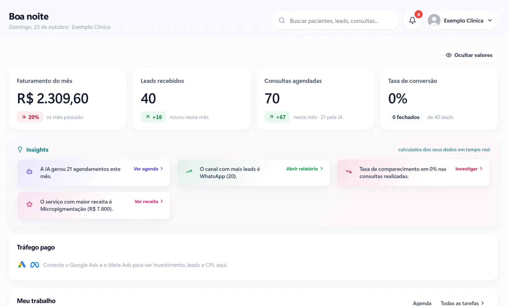

Cada falta é um horário que a clínica preparou, reservou e não vai receber. Some a isso o paciente da lista de espera que poderia ter vindo no lugar e o profissional parado, e a conta no fim do mês fica alta.

A boa notícia é que boa parte das faltas não é desinteresse, é esquecimento. E esquecimento se resolve com processo.

## Por que os pacientes faltam

Antes de automatizar, vale entender os motivos mais comuns:

- **Esquecimento.** A consulta foi marcada com semanas de antecedência e caiu da memória.
- **Imprevisto sem canal fácil para avisar.** O paciente até ia desmarcar, mas teria que ligar em horário comercial.
- **Dúvida que ninguém respondeu.** Preparo, endereço, valor ou documentos. Na dúvida, ele não vai.
- **Pouco vínculo com a clínica.** Quem marcou pela primeira vez e não recebeu nenhum contato depois sente menos compromisso.

Repare que três dos quatro motivos se resolvem com uma mensagem no momento certo.

## A confirmação que funciona

A confirmação automática no WhatsApp é o ponto de partida. Um modelo simples:

1. **Na hora do agendamento:** mensagem com dia, horário, profissional, endereço e orientações de preparo.
2. **Na véspera:** pedido de confirmação com botões, como "Confirmo", "Preciso remarcar" e "Falar com a recepção".
3. **Algumas horas antes:** lembrete curto, só para quem confirmou.

Os botões fazem diferença. Responder com um toque é mais fácil do que escrever, e a resposta já atualiza a agenda: quem confirmou aparece de uma cor, quem pediu para remarcar de outra, e quem não respondeu fica em destaque para a recepção ligar.

## Facilite a remarcação

Muita falta acontece porque desmarcar dá trabalho. Quando o paciente escolhe "Preciso remarcar", o próprio atendimento já oferece os horários livres, e a troca acontece na mesma conversa. Para a clínica, um horário remarcado é muito melhor do que um horário perdido.

[[cta]]

## O que fazer com o horário que ficou vago

Mesmo com tudo isso, alguns horários vão vagar. O que separa a clínica organizada da que perde dinheiro é a velocidade para preencher:

- **Lista de espera.** Pacientes que queriam um horário mais cedo recebem o aviso de vaga assim que alguém desmarca.
- **Retornos pendentes.** Quem está com retorno atrasado é um bom candidato para o horário livre.
- **Orçamentos em aberto.** Um contato oferecendo o horário pode ser o empurrão que faltava.

## Quem faltou também precisa de contato

O paciente que faltou não deve sumir da agenda. Uma mensagem educada no mesmo dia, oferecendo um novo horário, recupera parte dessas consultas. E o registro das faltas no histórico ajuda a clínica a decidir, por exemplo, quando pedir confirmação antecipada ou sinal para procedimentos mais longos.

## Acompanhe os números

Três números mostram se o processo está funcionando:

1. **Taxa de faltas por mês**, para comparar antes e depois.
2. **Taxa de confirmação**, ou seja, quantos pacientes respondem ao pedido da véspera.
3. **Horários vagos preenchidos**, para saber se a lista de espera está girando.

Com esses números no painel, a clínica sabe se precisa mudar o horário do lembrete, o texto da mensagem ou o jeito de oferecer as vagas.

## Perguntas frequentes

### Com quanto tempo de antecedência devo mandar a confirmação?

Para a maioria das clínicas, a véspera funciona bem: perto o bastante para o paciente lembrar e com tempo para a recepção preencher o horário se ele desmarcar. Procedimentos longos podem pedir uma confirmação extra alguns dias antes.

### Posso mandar lembretes pelo WhatsApp sem ter o número bloqueado?

Sim, usando a API oficial do WhatsApp Business. Ela permite enviar lembretes com modelos de mensagem aprovados pela Meta, sem o risco das ferramentas não oficiais.

### E se o paciente não responder a confirmação?

O sistema destaca quem não respondeu para a recepção fazer um contato direto. Com o tempo, dá para ver quais pacientes costumam não responder e tratar esses casos de forma diferente.

### A confirmação automática deixa o atendimento frio?

Não, se as mensagens forem escritas com a voz da clínica e o paciente puder falar com uma pessoa a qualquer momento. Para ele, receber o lembrete costuma ser um sinal de cuidado.
