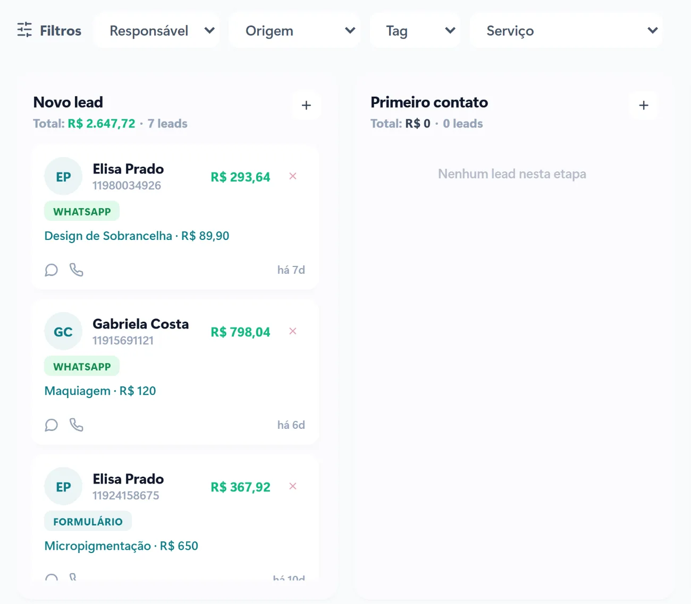

Na estética, a maior parte das vendas começa com uma pergunta simples no Instagram ou no WhatsApp: "Quanto custa?". O que acontece depois dessa pergunta define se a cliente vai agendar, se vai sumir ou se vai fechar com outro espaço.

Este passo a passo mostra onde as vendas costumam escapar e como organizar o caminho da cliente, do primeiro contato ao retorno.

## 1. Responda rápido, com informação útil

Quem pergunta o preço de um procedimento geralmente está comparando opções. Uma resposta rápida e completa, com valor, o que está incluído, tempo de sessão e próximos horários, vale mais do que uma resposta só com o número.

Fora do horário, o atendimento automático pode fazer essa primeira resposta e já oferecer os horários livres. Para dúvidas específicas, a conversa segue para a profissional.

## 2. Não deixe nenhum orçamento sem retorno

A cliente que recebeu o valor e disse "vou pensar" não disse não. Ela precisa de um motivo para decidir. Organize os pedidos em etapas:

1. **Novo contato**
2. **Orçamento enviado**
3. **Avaliação agendada**
4. **Procedimento feito**
5. **Retorno ou manutenção**

Com os pedidos em um quadro, fica fácil ver quem recebeu o orçamento há três dias e ainda não respondeu. Uma mensagem com um antes e depois, uma dúvida comum respondida ou uma condição especial do mês costuma trazer a conversa de volta.

## 3. Ofereça a avaliação

Para procedimentos de valor mais alto, a avaliação é a ponte entre a curiosidade e a decisão. Ela permite explicar o tratamento, alinhar expectativas e montar o plano de sessões. Deixe a avaliação fácil de marcar, com horários livres oferecidos na própria conversa.

[[cta]]

## 4. Venda o tratamento, não só a sessão

Muitos resultados dependem de mais de uma sessão ou de manutenção. Apresente o plano completo desde a avaliação: quantas sessões, o intervalo entre elas e o que esperar em cada etapa. Pacotes ajudam a cliente a se comprometer com o tratamento e dão previsibilidade para a clínica.

## 5. Lembre a cliente na hora certa de voltar

Procedimentos com manutenção têm um tempo certo para retornar. Quando esse prazo fica registrado, o sistema avisa na hora certa e a mensagem sai com o nome da cliente e o procedimento que ela fez. Esse retorno costuma ser a venda mais fácil do mês, porque a cliente já confia no trabalho.

## 6. Peça a avaliação no Google

Depois do atendimento, uma mensagem pedindo a avaliação no Google ajuda a próxima cliente a escolher a sua clínica. Avaliações reais e recentes pesam na decisão de quem está pesquisando e na posição da clínica no mapa do Google.

## 7. Saiba de onde vêm as clientes que fecham

Registre a origem de cada contato: Instagram, anúncio, Google, indicação. Depois de alguns meses, você sabe quais canais trazem clientes que realmente fecham e pode investir mais neles.

## Perguntas frequentes

### Devo passar o preço logo no primeiro contato?

Na maioria dos casos, sim, junto com o que está incluído e os próximos horários. Esconder o valor costuma afastar quem está comparando. Para procedimentos que dependem de avaliação, informe a faixa de valores e convide para a avaliação.

### Quantas vezes posso retomar um orçamento sem incomodar?

Duas ou três mensagens bem espaçadas, cada uma com uma informação útil, costumam ser o limite. Depois disso, deixe a porta aberta e registre o motivo, se a cliente disser.

### Como controlar as sessões de um pacote?

Com cada pacote registrado no sistema, mostrando as sessões usadas e as que faltam. Assim a cliente e a clínica sabem exatamente onde o tratamento está.

### Vale a pena automatizar o atendimento do Instagram?

Vale para as perguntas que se repetem e para oferecer horários. Dúvidas sobre o resultado e casos específicos devem continuar com a profissional.
