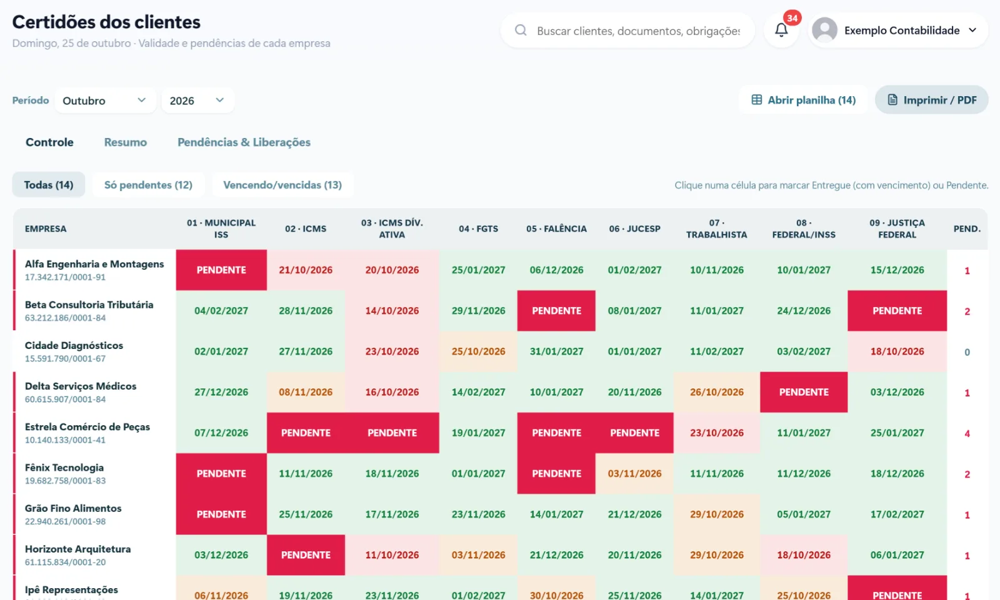

Licitação, financiamento, contrato com cliente grande: é quase sempre na hora que a empresa mais precisa que alguém descobre que a certidão venceu ou que tem uma pendência impedindo a emissão. Para o escritório de contabilidade, isso vira urgência, retrabalho e, às vezes, um cliente insatisfeito.

Controlar as certidões de todos os clientes com antecedência resolve esse problema. Veja como montar esse controle.

## Por que a planilha não dá conta

A planilha de certidões começa bem e vai se desatualizando:

- cada certidão tem uma **validade diferente** (a federal vale 180 dias, a do FGTS vale 30 dias, e as estaduais e municipais variam);
- alguém precisa lembrar de olhar a planilha todo dia;
- as pendências, que impedem a emissão, ficam anotadas em outro lugar;
- o cliente não vê nada e só descobre quando precisa.

## O que o controle precisa mostrar

Para cada empresa atendida, o controle ideal mostra em uma tela:

1. **Cada certidão** (federal, estadual, municipal, FGTS, trabalhista, falência e outras que o cliente usa).
2. **A data de validade** de cada uma.
3. **O status**: em dia, vencendo em breve, vencida ou pendente.
4. **As pendências** que impedem a emissão, com o que precisa ser resolvido.

Com cores para cada situação, o escritório enxerga em segundos quem precisa de atenção.

## Avisos antes de vencer

O controle só funciona se ninguém precisar lembrar de olhar. Os avisos automáticos fazem esse trabalho:

- **para o escritório:** lista semanal das certidões que vencem nos próximos dias;
- **para o cliente:** aviso de que a certidão foi renovada e está disponível no portal;
- **para as pendências:** alerta quando uma certidão não pode ser emitida, para resolver antes da urgência.

[[cta]]

## Certidão disponível no portal do cliente

Em vez de mandar o PDF por e-mail cada vez que o cliente pede, a certidão atualizada fica no portal do cliente, com a data de validade. Ele baixa quando precisar, e o escritório deixa de responder o mesmo pedido várias vezes.

## Relatório para a gestão do escritório

Uma visão geral ajuda a planejar a semana:

- quantas certidões vencem nos próximos 30 dias;
- quais empresas têm pendências;
- quais clientes estão com tudo em dia.

## Perguntas frequentes

### Com quanto tempo de antecedência devo renovar as certidões?

Depende do uso de cada cliente, mas renovar alguns dias antes do vencimento evita a correria. Para clientes que participam de licitações, vale manter as certidões sempre com folga.

### O cliente pode baixar a certidão sozinho?

Sim. Com o portal do cliente, a certidão atualizada fica disponível para download a qualquer hora, com a data de validade.

### Dá para importar as certidões que já controlo na planilha?

Sim. Na implantação, os dados da planilha atual são importados e passam a ser acompanhados pelo sistema.

### E quando a certidão não pode ser emitida por pendência?

Ela aparece como pendente, com o motivo. O escritório resolve a pendência com o cliente antes de a certidão ser necessária.
