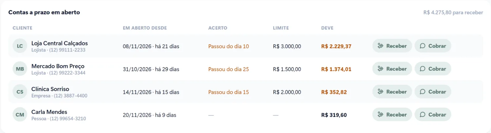

Todo restaurante tem aqueles clientes de confiança: o lojista da rua que almoça todo dia, a empresa vizinha que paga no fim do mês, o freguês antigo que acerta na sexta. Vender a prazo para eles é bom para o negócio, desde que o controle não fique em um caderno atrás do balcão.

Veja como organizar o fiado e as vendas a prazo para não perder dinheiro nem a amizade com o cliente.

## Os problemas do caderno

- **Anotação esquecida.** Na correria do almoço, a venda não é anotada, ou é anotada depois, de memória.
- **Letra que ninguém entende.** No dia do acerto, ninguém sabe ao certo o que foi consumido.
- **Sem limite.** A conta cresce sem ninguém perceber até virar um valor difícil de receber.
- **Sem data combinada.** "Depois eu acerto" vira um mês, dois, três.
- **Caixa que não fecha.** Venda a prazo misturada com venda paga confunde o fechamento do dia.

## Cadastre quem pode comprar a prazo

O primeiro passo é ter um cadastro simples de cada cliente que compra a prazo: nome, tipo (pessoa, lojista ou empresa), telefone, **limite de crédito** e **dia do acerto**. Só quem está cadastrado pode comprar assim.

Também vale definir quem pode liberar uma venda a prazo. No sistema da VCA, por exemplo, só o gerente libera, o que evita o "pode deixar que ele paga depois" sem controle.

## Lance o consumo na conta do cliente

Na hora de fechar a mesa, em vez de pagar, o consumo vai para a conta do cliente cadastrado. O sistema registra os itens, a data e quem atendeu. Na hora do acerto, o extrato mostra tudo, sem discussão.

## Cobre no dia combinado

Com o dia do acerto registrado, o sistema mostra quem passou da data. A cobrança pode sair pelo WhatsApp com o extrato do período, de forma educada e sem ninguém precisar ligar. Quando o cliente paga, o recebimento é lançado e a conta zera.

[[cta]]

## Separe o fiado do caixa do dia

Venda a prazo não é dinheiro que entrou. No fechamento, ela precisa aparecer separada: o caixa do dia mostra o que foi recebido em dinheiro, Pix e cartão, e à parte o total vendido a prazo e o que foi recebido de contas antigas. Assim a gaveta bate e você sabe exatamente quanto tem para receber.

## Acompanhe quem são os seus melhores clientes

O cadastro também mostra quem mais consome e o que mais pede. É uma informação valiosa: o lojista que almoça todo dia pode ganhar uma condição especial, e a empresa que fecha conta mensal pode virar um contrato de marmitas, por exemplo.

## Perguntas frequentes

### Qual limite dar para cada cliente?

Comece com um valor que você aceitaria perder sem quebrar o caixa e aumente conforme o histórico de pagamento. O sistema avisa quando a conta chega perto do limite.

### Posso mandar o extrato para o cliente pelo WhatsApp?

Sim. O extrato com os consumos do período sai pelo WhatsApp junto com a cobrança, e o cliente vê exatamente o que está pagando.

### Como fica o fiado no fechamento do caixa?

Separado. O caixa mostra o que entrou de verdade na gaveta e no banco, e à parte o que foi vendido a prazo e o que foi recebido de contas antigas.

### Dá para impedir venda a prazo para quem está atrasado?

Sim. Quem passou do dia do acerto ou estourou o limite aparece em destaque, e a nova venda a prazo depende da liberação do gerente.
