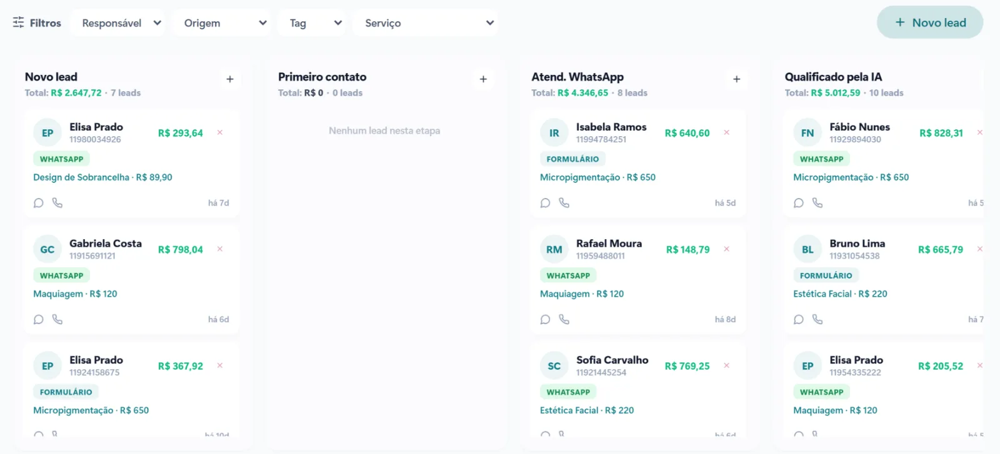
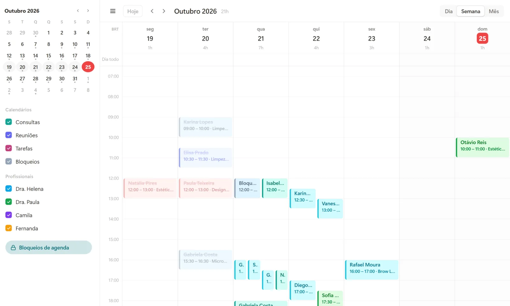

A maioria das clínicas não perde pacientes por falta de procura. Perde no meio do caminho: a mensagem que ficou sem resposta no sábado, o orçamento que ninguém retomou, o paciente que faltou e não foi remarcado, o retorno que ninguém lembrou de marcar.

Um CRM para clínicas existe para fechar esses buracos. Neste artigo você vai ver onde eles costumam estar e como organizar a jornada do paciente do primeiro contato até o retorno.

## Onde a clínica perde pacientes sem perceber

Antes de falar de sistema, vale olhar para os pontos de perda mais comuns:

- **Demora na primeira resposta.** Quem procura um procedimento costuma pesquisar mais de uma clínica ao mesmo tempo. Quem responde primeiro, com clareza, sai na frente.
- **Orçamento sem acompanhamento.** O paciente pede o valor, recebe, diz que vai pensar e ninguém volta a falar com ele.
- **Faltas sem remarcação.** O horário fica vazio e o paciente some da agenda.
- **Retornos esquecidos.** Procedimentos que pedem manutenção ou revisão dependem de alguém lembrar de chamar o paciente.
- **Informação espalhada.** Parte no WhatsApp da recepção, parte em uma planilha, parte no sistema da agenda. Ninguém tem a visão completa.

## O que é um CRM para clínicas

CRM é a sigla em inglês para gestão do relacionamento com o cliente. Em uma clínica, é o lugar onde cada paciente e cada interessado tem uma ficha, com o histórico de conversas, os orçamentos, as consultas e a etapa em que está.

Na prática, ele funciona como um quadro com colunas, por exemplo: **Novo contato → Orçamento enviado → Agendado → Atendido → Retorno**. Cada paciente é um cartão que anda pelas colunas. Quando um cartão fica parado tempo demais, o sistema avisa.

[[cta]]

## O que um bom CRM para clínicas precisa ter

### Integração com o WhatsApp

Se os pacientes falam com a clínica pelo WhatsApp, o CRM precisa estar ligado a ele. Cada conversa nova vira um contato no quadro automaticamente, sem ninguém precisar copiar nome e telefone à mão.

### Agenda no mesmo lugar

Quando o CRM e a agenda conversam, o agendamento muda o paciente de etapa sozinho, e a recepção vê na hora quem já marcou e quem ainda está decidindo.

### Lembretes automáticos

Confirmação da consulta no dia anterior, aviso de horário e mensagem de remarcação para quem faltou. Lembretes simples reduzem faltas e devolvem horários para a agenda.

### Acompanhamento de orçamentos

O sistema mostra quais orçamentos estão sem resposta há alguns dias e sugere o contato. É uma das formas mais baratas de recuperar faturamento que já estava quase perdido.

### Relatórios que a dona da clínica entende

Quantos contatos chegaram no mês, quantos agendaram, quantos fecharam e de onde vieram (Instagram, Google, indicação). Com isso dá para saber em qual canal vale investir mais.

## Atendimento com IA na clínica: até onde ir

A inteligência artificial ajuda muito na recepção: responde dúvidas sobre procedimentos, horários, preparo e localização, e já oferece os horários livres para agendar. Mas ela tem limites claros:

- não faz diagnóstico nem orientação clínica;
- passa para uma pessoa qualquer dúvida sobre saúde do paciente;
- segue as regras do conselho da sua área para comunicação e publicidade.

Configurada assim, a IA tira da recepção o volume de perguntas repetidas e deixa a equipe livre para cuidar de quem está na clínica.

## E a LGPD?

Dados de saúde são considerados dados pessoais sensíveis pela Lei Geral de Proteção de Dados. Isso pede alguns cuidados no sistema:

- acesso por usuário, com permissões diferentes para recepção, profissionais e gestão;
- registro de quem viu e alterou cada informação;
- nada de planilhas com dados de pacientes circulando por e-mail ou grupos;
- conversas guardadas em ambiente seguro, e não só no celular de alguém.

## Como começar

1. Liste de onde vêm os seus pacientes hoje e por quais canais eles falam com a clínica.
2. Desenhe as etapas da jornada, do primeiro contato ao retorno.
3. Defina quais mensagens podem ser automáticas e quais ficam com a recepção.
4. Migre os contatos atuais para o CRM, começando pelos orçamentos em aberto.
5. Acompanhe os números por dois ou três meses e ajuste os pontos de perda.

## Perguntas frequentes

### Qual a diferença entre CRM e sistema de prontuário?

O prontuário guarda a parte clínica do atendimento. O CRM cuida do relacionamento: contatos, conversas, orçamentos, agenda, lembretes e retornos. Os dois podem andar juntos, cada um com a sua função.

### CRM serve para consultório pequeno?

Sim. Em consultórios pequenos, normalmente uma pessoa faz recepção, agenda e cobrança. Um CRM com lembretes e respostas automáticas é o que libera o tempo dela.

### Preciso trocar o número de WhatsApp da clínica?

Não. O número atual pode ser ligado ao sistema por meio da API oficial do WhatsApp Business, mantendo o contato que os pacientes já conhecem.

### Em quanto tempo o CRM começa a dar resultado?

A organização aparece logo nas primeiras semanas, quando os contatos param de se perder. Os ganhos em agendamentos e retornos ficam claros entre 60 e 90 dias, quando já existe histórico para comparar.
