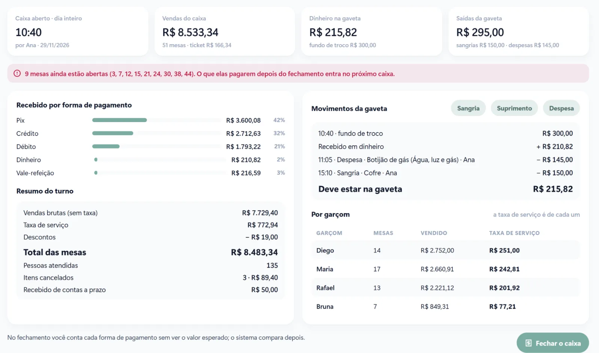

Caixa que não bate é um dos problemas mais comuns em restaurantes e um dos mais caros, porque a diferença de cada dia parece pequena e, no fim do mês, vira um valor que faz falta. Na maioria das vezes não é desonestidade: é processo frouxo.

Este passo a passo mostra como fechar o caixa todos os dias e descobrir na hora se faltou ou sobrou dinheiro.

## 1. Abra o caixa com o fundo de troco registrado

Todo turno começa com um valor em dinheiro na gaveta para troco. Esse valor precisa ser registrado na abertura, com o nome de quem abriu. Sem isso, no fim do dia ninguém sabe ao certo quanto deveria haver na gaveta.

## 2. Registre toda saída de dinheiro

Pagamento de fornecedor, compra de gelo, gás, retirada para o cofre: toda saída de dinheiro da gaveta precisa ser lançada na hora, com o motivo e quem fez.

- **Sangria:** retirada de dinheiro para o cofre ou para o banco.
- **Despesa:** pagamento feito com o dinheiro da gaveta.
- **Suprimento:** dinheiro colocado na gaveta durante o turno.

## 3. Cancelamento só com motivo

Item cancelado sem motivo é uma das portas por onde o dinheiro escapa. Exija o motivo em todo cancelamento e acompanhe quem cancela e quanto. O mesmo vale para descontos: só com autorização do gerente.

## 4. Confira as mesas abertas antes de fechar

Mesa aberta no fechamento é venda que pode se perder. O sistema avisa quais mesas ainda estão abertas, e o que for pago depois entra no caixa seguinte.

[[cta]]

## 5. Conte a gaveta às cegas

Este é o passo mais importante. Quem fecha o caixa conta o dinheiro e informa o total de cada forma de pagamento **sem ver o valor esperado**. Só depois o sistema compara com o que deveria haver e mostra a diferença.

Por que às cegas? Porque quem vê o número esperado tende a "ajustar" a contagem para bater, e o problema real fica escondido.

## 6. Confira as maquininhas e o Pix

O dinheiro é só uma parte. Compare o total de cartão com o relatório das maquininhas e o total de Pix com o extrato do banco. Diferenças aqui costumam vir de pagamento lançado na forma errada, como cartão registrado como dinheiro.

## 7. Feche e guarde o relatório

O fechamento termina com um relatório: vendas do turno, formas de pagamento, cancelamentos, sangrias, despesas, vendas por garçom e a diferença encontrada. Guardar esse histórico mostra padrões, como diferenças que se repetem em um turno ou com uma pessoa.

## Perguntas frequentes

### Quantas vezes por dia devo fechar o caixa?

Pelo menos uma vez por turno, a cada troca de responsável. Se a mesma pessoa fica o dia todo, um fechamento no fim do dia basta.

### O que fazer quando a diferença é pequena?

Registrar sempre, mesmo que seja pouco. Diferenças pequenas e frequentes são um sinal de processo frouxo, e o histórico mostra onde estão.

### Como tratar as vendas a prazo no fechamento?

Separadas do que entrou de verdade. Venda a prazo aparece à parte, e o que for recebido de contas antigas entra como recebimento do dia.

### Preciso de internet para fechar o caixa?

Não, se o sistema funcionar sem internet. No sistema da VCA, o caixa fecha normalmente offline e os dados sobem quando a conexão volta.
