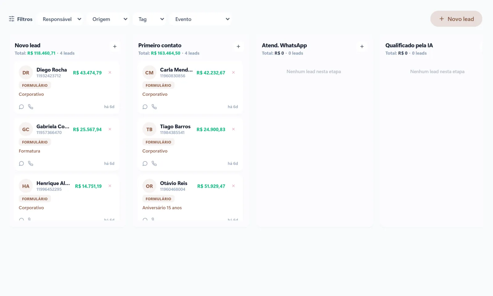
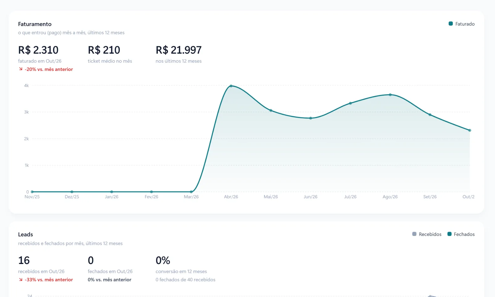

Muitas empresas vendem quase tudo pelo WhatsApp, mas não sabem dizer quantas conversas viraram clientes no mês passado. Sem essa resposta, cada mês de vendas depende da memória e da boa vontade de quem atende.

Um funil de vendas no WhatsApp organiza essas conversas em etapas, mostra onde os contatos param e garante que ninguém fique esquecido. Veja como montar o seu.

## O que é um funil de vendas

Funil de vendas é o caminho que uma pessoa percorre desde o primeiro contato até virar cliente. Ele se chama funil porque, a cada etapa, alguns contatos ficam pelo caminho. O objetivo não é que todos comprem, e sim saber exatamente em que ponto eles desistem para melhorar esse ponto.

Um funil simples, que funciona para a maioria das empresas que vendem pelo WhatsApp:

1. **Novo contato:** a pessoa mandou a primeira mensagem.
2. **Em conversa:** você entendeu o que ela procura.
3. **Proposta enviada:** ela recebeu preço, orçamento ou condições.
4. **Negociação:** está decidindo, com dúvidas ou comparando.
5. **Fechado:** virou cliente.
6. **Perdido:** desistiu, com o motivo anotado.

## Passo 1: tire as conversas do celular de cada vendedor

O primeiro problema do funil no WhatsApp é que ele mora em vários celulares. Quando um vendedor sai da empresa ou entra de férias, as conversas vão junto.

O caminho é centralizar o número da empresa em um sistema com vários atendentes, usando a API oficial do WhatsApp Business. Assim todas as conversas ficam em um lugar só, com histórico, e qualquer pessoa da equipe consegue continuar o atendimento.

## Passo 2: ligue o WhatsApp a um CRM

Cada nova conversa deve virar um cartão no CRM automaticamente, na etapa "Novo contato". A partir daí, a equipe move o cartão conforme a conversa avança. Em um quadro com colunas, dá para ver de relance quantos contatos estão em cada etapa e quais estão parados.

[[cta]]

## Passo 3: defina o que acontece em cada etapa

Para o funil não virar só um quadro bonito, cada etapa precisa de uma ação clara:

- **Novo contato:** responder em poucos minutos. Fora do horário, uma resposta automática já acolhe e coleta as informações principais.
- **Em conversa:** fazer as perguntas certas para entender necessidade, prazo e orçamento.
- **Proposta enviada:** marcar a data para retomar o contato.
- **Negociação:** responder objeções, enviar depoimentos e casos parecidos.
- **Perdido:** registrar o motivo. Preço? Prazo? Comprou do concorrente? Esses motivos dizem muito sobre o que melhorar.

## Passo 4: automatize o acompanhamento

A maior parte das vendas perdidas no WhatsApp não é um "não". É um silêncio depois da proposta. Uma sequência de acompanhamento resolve boa parte disso:

- **Dois dias depois da proposta:** "Conseguiu ver a proposta? Ficou alguma dúvida?"
- **Uma semana depois:** uma informação útil, como um caso de cliente parecido ou uma condição que vence em breve.
- **Duas semanas depois:** uma mensagem de encerramento educada, deixando a porta aberta.

O sistema pode lembrar o vendedor de cada contato ou enviar parte dessas mensagens sozinho, sempre respeitando as regras do WhatsApp oficial para mensagens fora da janela de 24 horas.

## Passo 5: acompanhe os números certos

Com o funil organizado, quatro números contam a história das suas vendas:

1. **Contatos novos no mês**, e de onde vieram: Instagram, Google, indicação, anúncio.
2. **Tempo da primeira resposta.** Quanto mais rápido, maior a chance de fechar.
3. **Taxa de conversão de cada etapa.** Por exemplo, de cada 10 propostas enviadas, quantas fecharam.
4. **Motivos de perda mais comuns.**

Olhando esses números todo mês, você sabe se o problema está em atrair contatos, em responder rápido ou em fechar a venda, e investe no ponto certo.

## Erros comuns

- Mandar a proposta e esperar o cliente voltar sozinho.
- Ter um funil com etapas demais, que ninguém atualiza.
- Disparar mensagens em massa por ferramentas não oficiais e ter o número bloqueado.
- Não anotar por que o cliente desistiu.

## Perguntas frequentes

### Preciso de um CRM para ter um funil no WhatsApp?

Para poucas vendas por mês, uma planilha bem cuidada até funciona. Mas, quando o volume cresce, só um CRM ligado ao WhatsApp garante que cada contato seja registrado e acompanhado sem depender de memória.

### Quantas etapas o funil deve ter?

Entre quatro e seis costuma ser o ideal. Menos que isso esconde onde os contatos param; mais que isso faz a equipe deixar de atualizar o quadro.

### Posso enviar mensagens automáticas para quem não respondeu?

Sim, pela API oficial do WhatsApp Business, usando modelos de mensagem aprovados quando a última mensagem do cliente tiver mais de 24 horas. Ferramentas não oficiais colocam o número da empresa em risco de bloqueio.

### Como saber de onde vêm os meus clientes?

Perguntando no primeiro contato e registrando a origem no CRM, ou usando links com identificação em cada canal. Com o tempo, os relatórios mostram quais canais trazem os clientes que mais fecham.
