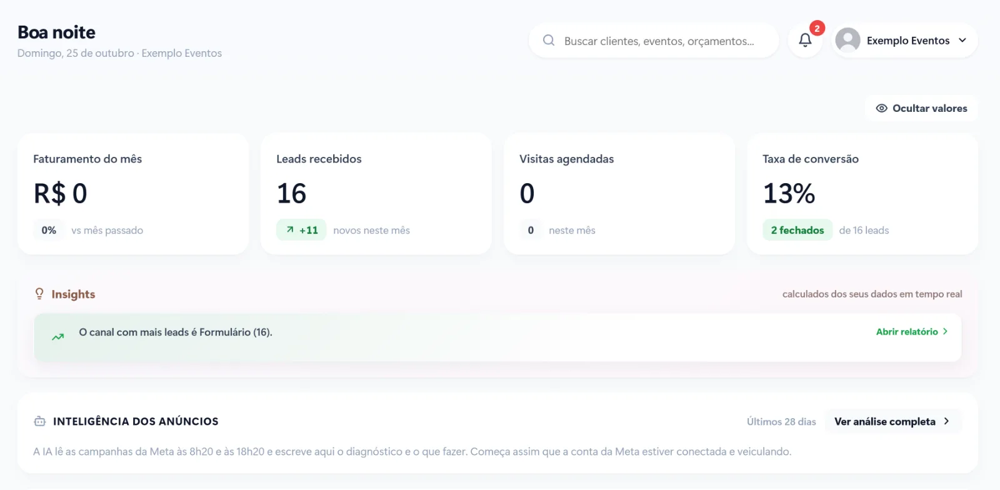

Quem está organizando uma festa pede orçamento para vários lugares ao mesmo tempo. Casamento, aniversário de 15 anos, formatura ou evento corporativo: a casa que responde primeiro, com clareza e com a data confirmada, sai muito na frente.

Veja como organizar o caminho do pedido de orçamento até o contrato assinado.

## Os pedidos que escapam

- **Resposta demorada.** O pedido chegou no sábado à noite e só foi respondido na segunda.
- **Informação faltando.** A casa precisa perguntar data, número de convidados e tipo de evento antes de mandar o valor, e a conversa se arrasta.
- **Data incerta.** Ninguém tem certeza se a data está livre sem conferir em vários lugares.
- **Orçamento sem retorno.** O cliente recebeu a proposta e ninguém voltou a falar com ele.

## 1. Colete o essencial logo no primeiro contato

O atendimento automático do Instagram e do WhatsApp pode perguntar logo de cara o que define o orçamento: **tipo de evento, data, número de convidados e horário**. Com isso, o pedido já chega completo para a equipe, e a resposta sai muito mais rápida.

## 2. Confira a data antes de responder

Antes de mandar o valor, confirme se a data está livre. Com um calendário único, que mostra os eventos fechados e as datas em negociação, a resposta sai com segurança. Se a data já estiver ocupada, ofereça as próximas livres na mesma conversa.

## 3. Organize os pedidos em um funil

Cada pedido vira um cartão que anda pelas etapas:

1. **Pedido recebido**
2. **Orçamento enviado**
3. **Visita agendada**
4. **Negociação**
5. **Contrato fechado**

O painel mostra quantos pedidos chegaram no mês, quantas visitas foram agendadas e a taxa de conversão, além do canal que mais traz orçamento.

[[cta]]

## 4. Visita marcada sem conflito

Para muitos eventos, a visita ao espaço é o momento da decisão. Ofereça os horários livres na própria conversa e mande o lembrete na véspera. Depois da visita, registre a impressão do cliente e marque a data para retomar o contato.

## 5. Contrato, sinal e parcelas sem cobrança manual

Quando o cliente decide, o contrato sai com os dados do evento, e o sinal e as parcelas ficam registrados com as datas de vencimento. Os lembretes saem antes de cada parcela, e a baixa é automática quando o pagamento entra.

## 6. Use as datas livres a seu favor

Com o calendário à vista, as datas vagas dos próximos meses viram oportunidade: uma condição especial para uma sexta-feira livre ou uma campanha para o mês mais fraco ajudam a preencher a agenda.

## Perguntas frequentes

### Devo mandar o valor do orçamento logo no primeiro contato?

Quando o pedido já tem tipo de evento, data e número de convidados, sim, junto com o que está incluído. Se faltar informação, colete primeiro para não mandar um valor errado.

### Como evitar dois eventos na mesma data?

Com um calendário único, consultado antes de cada resposta e atualizado assim que o contrato é fechado.

### O sistema avisa as parcelas para o cliente?

Sim. Cada parcela tem lembrete antes do vencimento e baixa automática quando o pagamento entra.

### Consigo saber qual canal traz os eventos que fecham?

Sim. Cada pedido entra com a origem marcada, e o painel mostra quanto cada canal trouxe de contratos fechados.
