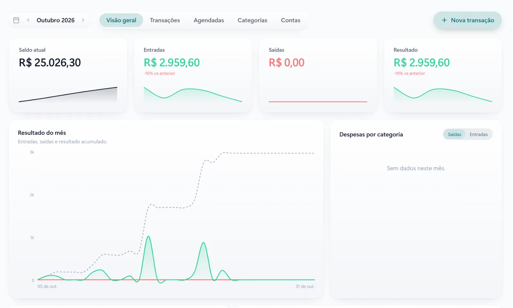

Pacotes são ótimos para a clínica de estética: garantem o tratamento completo, trazem previsibilidade de caixa e aumentam o valor de cada cliente. Mas, controlados no caderno ou na memória, viram fonte de prejuízo e de conversa desconfortável.

Quantas sessões a cliente já fez? O pacote ainda está na validade? A terceira parcela foi paga? Veja como organizar tudo isso.

## Onde o controle de pacotes costuma falhar

- **Sessão feita e não registrada.** No fim do pacote, a contagem da clínica e a da cliente não batem.
- **Validade esquecida.** O pacote venceu, mas ninguém avisou, e a cliente aparece querendo usar o que sobrou.
- **Parcelas sem acompanhamento.** O tratamento continua enquanto o pagamento ficou para trás.
- **Pacote parado.** A cliente comprou, fez duas sessões e sumiu. Ninguém percebeu.

## O que registrar em cada pacote

Para o controle funcionar, cada pacote precisa de algumas informações básicas:

1. **Procedimento e número de sessões.**
2. **Intervalo recomendado** entre as sessões.
3. **Validade**, combinada com a cliente no momento da compra.
4. **Valor e forma de pagamento**, com as parcelas e as datas.
5. **Sessões realizadas**, com data e profissional.

Com isso no sistema, qualquer pessoa da equipe vê na hora o saldo da cliente, sem consultar caderno nem perguntar para a colega.

## Baixa automática da sessão

O ideal é que a sessão seja descontada do pacote quando o atendimento é marcado como concluído na agenda. Assim o registro não depende de alguém lembrar de anotar depois.

[[cta]]

## Lembretes que mantêm o tratamento em dia

Pacote parado é resultado que não aparece e cliente insatisfeita. Os lembretes resolvem boa parte disso:

- **Próxima sessão:** quando o intervalo recomendado chega, a cliente recebe o convite para agendar.
- **Validade chegando:** um aviso algumas semanas antes do vencimento, com as sessões que ainda restam.
- **Parcela vencendo:** lembrete antes do vencimento e baixa automática quando o pagamento entra.

## Combine as regras por escrito

Muita discussão some quando as regras estão claras desde a venda: validade, o que acontece se a cliente faltar sem avisar, se a sessão pode ser transferida para outra pessoa e como funciona a troca de procedimento. Mande essas regras junto com o comprovante do pacote.

## O que acompanhar no fim do mês

- pacotes vendidos e o valor total;
- sessões realizadas e sessões a realizar;
- pacotes parados há mais de um intervalo;
- parcelas em atraso.

Esses números mostram se a clínica está vendendo tratamentos que de fato acontecem e onde é preciso agir.

## Perguntas frequentes

### Qual validade dar para um pacote?

Depende do procedimento e do intervalo entre as sessões. Uma regra prática é somar o tempo do tratamento completo com uma folga para imprevistos, e combinar isso com a cliente na hora da venda.

### A cliente pode ver quantas sessões ainda tem?

Sim. O saldo pode ser enviado pelo WhatsApp sempre que ela pedir ou junto com o lembrete da próxima sessão.

### Como lidar com pacote pago em parcelas?

Cada parcela fica registrada com a data de vencimento, recebe lembrete antes de vencer e dá baixa sozinha quando o pagamento entra por Pix ou cartão.

### Vale a pena oferecer pacotes para todos os procedimentos?

Vale para os procedimentos que dependem de mais de uma sessão ou de manutenção. Para procedimentos de sessão única, o melhor caminho costuma ser o lembrete de retorno.
