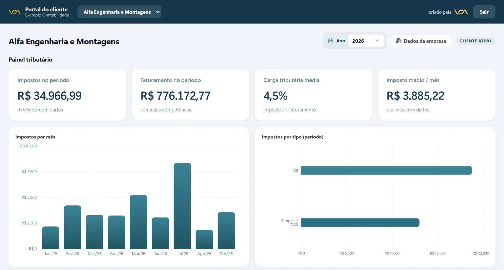

O portal do cliente é um endereço onde cada empresa atendida pelo escritório de contabilidade entra com o próprio acesso e encontra tudo o que é dela: guias, impostos, certidões, documentos e relatórios. É o fim do "você me mandou a guia?" e do anexo perdido no meio do WhatsApp.

Veja o que um bom portal deve ter e como implantar sem parar o escritório.

## O que o portal do cliente resolve

- **Guias espalhadas.** Tudo fica em um lugar só, organizado por mês.
- **Pedidos repetidos.** O cliente baixa a certidão ou o relatório quando precisa, sem pedir para o escritório.
- **Falta de visão.** O empresário vê os impostos do período, o faturamento e a carga tributária, e entende melhor o próprio negócio.
- **Documentos que não chegam.** O portal mostra o que o escritório está esperando do cliente.

## O que um bom portal precisa ter

1. **Acesso individual e seguro.** Cada empresa vê só o que é dela.
2. **Guias com status.** A pagar, paga ou em atraso, com o vencimento.
3. **Certidões com validade.** Prontas para baixar.
4. **Documentos organizados por mês e por tipo.**
5. **Avisos automáticos** por e-mail e WhatsApp quando algo novo chega.
6. **Funcionar no celular**, sem precisar instalar aplicativo.
7. **A marca do escritório**, para o cliente reconhecer de quem é o portal.

## Como implantar sem parar o escritório

### Comece pelo cadastro

Importe a base de clientes com CNPJ, contatos e regime tributário. Esse cadastro é a base de tudo.

### Ligue as pastas que você já usa

Se o escritório guarda os arquivos no Google Drive, o portal pode ler essas pastas e organizar os arquivos no espaço de cada empresa. A equipe continua salvando onde sempre salvou.

[[cta]]

### Libere para um grupo de clientes primeiro

Escolha alguns clientes mais próximos, libere o portal, colha as dúvidas e ajuste. Depois, estenda para todos com um comunicado explicando o que muda.

### Ative os avisos aos poucos

Comece com o aviso de guia disponível e de vencimento. Depois, inclua certidões e documentos pendentes.

## Como apresentar o portal para os clientes

Uma mensagem curta funciona melhor que um manual: o que é, o endereço, como entrar e o que o cliente vai encontrar. Um vídeo de um minuto mostrando o portal ajuda quem tem menos familiaridade com tecnologia.

## Perguntas frequentes

### O portal substitui o software contábil do escritório?

Não. Ele organiza a comunicação e os documentos com o cliente e funciona junto com o software fiscal e contábil que o escritório já usa.

### O cliente precisa instalar algum aplicativo?

Não. O portal abre no navegador e pode ser adicionado à tela inicial do celular como se fosse um aplicativo.

### Quanto tempo leva para implantar?

O cadastro e a ligação com as pastas costumam levar poucas semanas. A liberação para todos os clientes pode ser feita em etapas.

### E se o cliente preferir continuar recebendo por WhatsApp?

Os avisos continuam chegando pelo WhatsApp e pelo e-mail, com o link para o portal. Com o tempo, a maioria passa a usar o portal pela praticidade.
