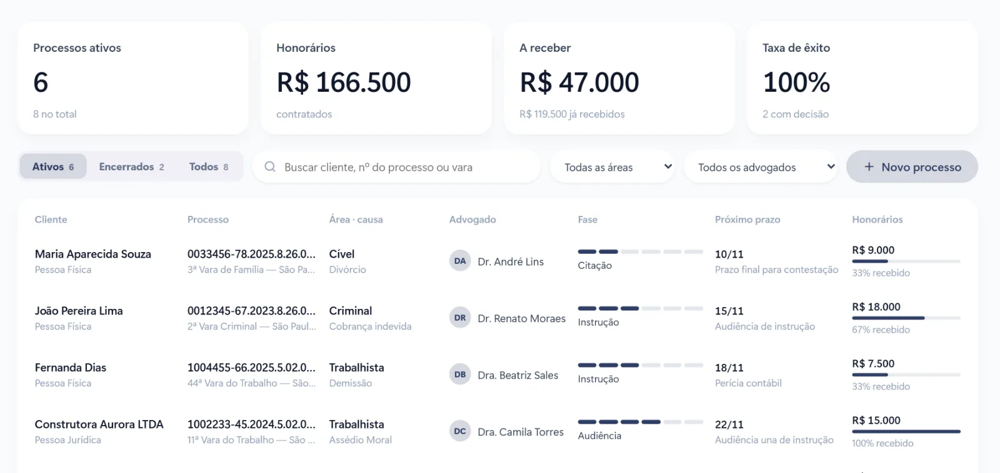

No escritório de advocacia, desorganização custa caro de um jeito diferente: um prazo perdido não se recupera. E, além dos prazos, há o cliente que liga para saber do processo, o novo caso que chegou pelo WhatsApp e ninguém respondeu, e o honorário parcelado que ninguém cobrou.

Veja como organizar a rotina do escritório em quatro frentes.

## 1. Prazos e audiências em um só lugar

O primeiro passo é tirar os prazos da planilha, do caderno e da memória e colocar tudo em um painel único, com cada processo mostrando:

- cliente, número do processo, área e vara;
- fase atual;
- **próximo prazo** e o que precisa ser feito;
- advogado responsável.

Com os processos em uma tela, ordenados pelo próximo prazo, a equipe começa a semana sabendo o que vence primeiro. Audiências e compromissos entram na agenda do escritório, sincronizada com o Google Agenda de cada advogado. Lembre que, no processo civil, os prazos são contados em dias úteis, e o controle precisa considerar isso.

## 2. Triagem dos novos casos

Quem procura um advogado geralmente está preocupado e quer resposta rápida. Uma triagem organizada ajuda o escritório a responder bem e a não perder bons casos:

1. o contato chega pelo site, pelo Google, por indicação ou pelo WhatsApp;
2. as perguntas iniciais identificam a área e a urgência;
3. o caso entra no funil e a primeira consulta é agendada;
4. depois da consulta, a proposta de honorários fica registrada e acompanhada.

Assim nenhum contato fica esquecido, e o escritório sabe de onde vêm os clientes que fecham.

[[cta]]

## 3. Cliente informado sem precisar ligar

Boa parte das ligações para o escritório é o cliente querendo saber como está o caso. Combine com ele a forma de atualização e use os avisos automáticos por e-mail ou WhatsApp quando houver novidade no processo. O cliente se sente acompanhado, e a equipe para de interromper o trabalho para repetir a mesma informação.

## 4. Honorários com cobrança automática

Honorários parcelados precisam de acompanhamento. Cada parcela registrada com a data de vencimento, um lembrete antes de vencer e a baixa automática quando o pagamento entra por Pix ou boleto. O relatório mostra quanto o escritório tem a receber e quem está em atraso, sem planilha paralela.

## O que acompanhar todo mês

- processos ativos e encerrados;
- prazos da semana e do mês;
- novos casos recebidos e quantos viraram contrato;
- honorários contratados, recebidos e em atraso.

## Perguntas frequentes

### O sistema serve para advogado que trabalha sozinho?

Sim. Para quem trabalha sozinho, ter os prazos, os clientes e os honorários em um só lugar é ainda mais importante, porque não há equipe para dividir o controle.

### Como o cliente recebe as atualizações do processo?

Por e-mail ou WhatsApp, nos momentos combinados com ele, sem precisar ligar para o escritório.

### Dá para controlar os honorários parcelados?

Sim. Cada parcela tem lembrete antes do vencimento e baixa automática quando o pagamento entra.

### Os documentos dos clientes ficam organizados?

Sim. Os documentos podem ficar nas pastas do Google Drive do escritório, ligadas a cada cliente e processo.
