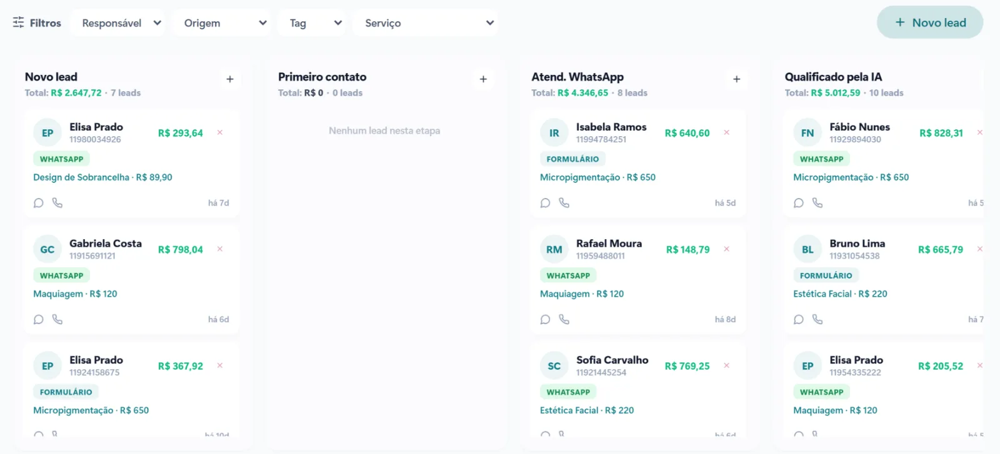

"Quanto custa?" é uma das primeiras perguntas de quem pensa em organizar as vendas com um CRM. A resposta honesta é: depende do que está incluído. Dois sistemas com a mesma mensalidade podem ter custos finais muito diferentes.

Veja o que forma o preço de um CRM com automação e como calcular se ele se paga na sua empresa.

## O que forma o preço

### Mensalidade do sistema

É o valor fixo para usar o sistema. Alguns cobram por usuário, outros por plano com um número de usuários, contatos ou recursos. Vale perguntar o que acontece quando a equipe cresce.

### Implantação

Cadastro dos dados, configuração das etapas do funil, das automações e das integrações, e treinamento da equipe. Há sistemas em que você faz tudo sozinho e outros em que a implantação é feita por especialistas. Implantação bem feita é o que define se o sistema vai ser usado de verdade.

### WhatsApp oficial

Se o CRM se conecta ao WhatsApp pela API oficial, há o custo das mensagens cobradas pela Meta, como lembretes, avisos e campanhas. Desde outubro de 2026, as respostas de atendimento dentro da janela de 24 horas também passaram a ser cobradas. Peça uma estimativa com base no volume de conversas da sua empresa e confira a tabela oficial da Meta.

### Integrações e automações

Agenda, cobrança, e-mail, planilhas e anúncios. Alguns sistemas cobram à parte por cada integração ou exigem ferramentas extras pagas.

### Suporte e ajustes

Quem ajuda quando algo muda no seu processo? Suporte incluído, ajustes nas automações e evolução do sistema fazem diferença no custo ao longo do tempo.

[[cta]]

## Os custos que ficam escondidos

- **Ferramentas paralelas.** O CRM não faz agenda, então você paga outra. Não faz cobrança, então mais uma.
- **Tempo da equipe.** Sistema difícil de usar consome horas e acaba abandonado.
- **Migração.** Levar os contatos e o histórico para o sistema novo.
- **Custo de não ter.** Contatos que esfriam, orçamentos sem retorno e faltas que ninguém confirmou.

## Como calcular se o CRM se paga

Uma conta simples ajuda a decidir. Use os números da sua empresa:

1. **Quantos contatos novos chegam por mês?**
2. **Quantos viram clientes hoje?**
3. **Quanto vale, em média, um cliente novo?**

Agora imagine um exemplo: uma empresa recebe 100 contatos por mês e fecha 10, com ticket médio de R$ 500. Se a organização do funil e o acompanhamento dos orçamentos fizerem ela fechar mais 3 clientes por mês, são R$ 1.500 a mais, sem contar o tempo que a equipe ganha. Os números são só um exemplo: o importante é fazer a conta com os seus.

## Perguntas para fazer antes de contratar

- O que está incluído na mensalidade e o que é cobrado à parte?
- Quem faz a implantação e o treinamento?
- O WhatsApp é conectado pela API oficial?
- O sistema tem agenda, cobrança e relatórios, ou vou precisar de outras ferramentas?
- Como é o suporte quando eu precisar mudar alguma coisa?

## Perguntas frequentes

### Existe CRM gratuito?

Existem versões gratuitas com recursos limitados, que podem servir para começar. Para automação de WhatsApp, agenda e cobrança integradas, normalmente é preciso um plano pago.

### Vale mais a pena um CRM pronto ou um sistema sob medida?

O CRM pronto é mais rápido de começar, mas pode exigir que a empresa se adapte a ele. O sistema montado para o seu nicho já vem com as etapas, as automações e as integrações que o seu negócio usa.

### Quanto tempo leva para o CRM dar retorno?

A organização aparece nas primeiras semanas. O retorno em vendas costuma ficar claro entre 60 e 90 dias, quando já existe histórico para comparar.

### A VCA divulga os preços no site?

O valor depende do nicho, do tamanho da equipe e das integrações. No diagnóstico gratuito, mostramos o sistema montado para o seu negócio e passamos o valor exato, sem compromisso.
