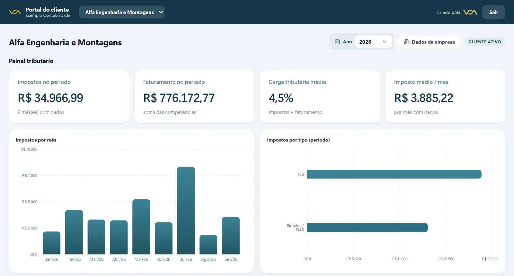
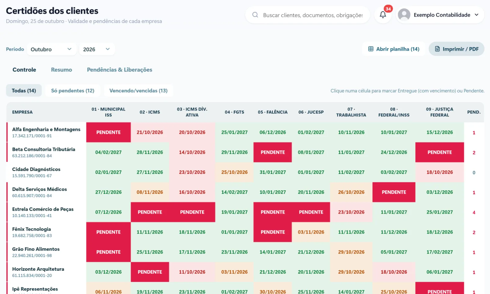

Todo mês é a mesma corrida: gerar as guias, mandar para cada cliente, confirmar se ele recebeu, cobrar quem não pagou, pedir os documentos que faltam, conferir certidões vencendo. Boa parte do tempo do escritório vai para mensagens e anexos, e não para o trabalho contábil em si.

Um sistema para escritório de contabilidade não substitui o software fiscal que você já usa. Ele organiza tudo o que acontece em volta dele: a comunicação com o cliente, os prazos e os documentos.

## Onde o tempo do escritório vai embora

- **Envio de guias um por um.** Baixar, renomear, anexar e mandar no WhatsApp ou no e-mail de cada empresa.
- **"Você recebeu?"** Confirmar recebimento e responder quem diz que não chegou nada.
- **Documentos que não chegam.** Notas, extratos e folha de pagamento pedidos várias vezes.
- **Certidões vencendo.** As certidões têm prazo de validade (a federal, por exemplo, vale 180 dias) e o cliente só lembra quando precisa dela para uma licitação ou um financiamento.
- **Informação espalhada.** Parte no e-mail, parte no WhatsApp, parte em pastas no computador de alguém.

## Portal do cliente: o centro da organização

A peça mais importante é o **portal do cliente**: um endereço onde cada empresa atendida entra com o próprio acesso e encontra, organizado por mês:

- as guias para pagar, com o vencimento e o status de pagamento;
- as certidões, com a data de validade de cada uma;
- os documentos e relatórios enviados pelo escritório;
- o que o escritório está esperando dele.

Com isso, a pergunta "você me mandou a guia?" deixa de existir. Está tudo no portal, e o cliente recebe um aviso quando algo novo chega.

[[cta]]

## Avisos automáticos que poupam o escritório

Com as guias e os prazos dentro do sistema, os avisos podem sair sozinhos:

1. **Guia disponível.** O cliente recebe por e-mail ou WhatsApp o aviso de que a guia do mês já está no portal.
2. **Vencimento chegando.** Lembrete alguns dias antes do vencimento, como o do DAS do Simples Nacional, que vence no dia 20.
3. **Guia em atraso.** Aviso automático para quem ainda não pagou, sem ninguém do escritório precisar cobrar.
4. **Certidão vencendo.** Alerta com antecedência, para renovar antes de o cliente precisar.
5. **Documento pendente.** Lembrete para o cliente enviar o que falta para fechar o mês.

## Integração com o Google Drive

Muitos escritórios já guardam os arquivos dos clientes em pastas no Google Drive. Em vez de mudar esse hábito, o sistema pode ler as pastas e organizar os arquivos no portal de cada empresa automaticamente. O escritório continua salvando onde sempre salvou, e o cliente vê tudo organizado do lado dele.

## Gestão do escritório

Além do portal, o sistema dá à gestão uma visão que a planilha não dá:

- quais clientes estão com guias em atraso;
- quais certidões vencem nos próximos 30 dias;
- quais empresas ainda não mandaram os documentos do mês;
- o histórico de impostos de cada cliente, mês a mês;
- a cobrança dos honorários, com aviso de fatura em atraso.

## Como implantar sem parar o escritório

1. **Comece pelo cadastro.** Importe a base de clientes que você já tem, com CNPJ, contatos e regime tributário.
2. **Ligue as pastas.** Conecte o Google Drive para que os arquivos apareçam no portal de cada empresa.
3. **Libere o portal aos poucos.** Comece por um grupo de clientes, colha as dúvidas e depois estenda para todos.
4. **Ative os avisos.** Primeiro guia disponível e vencimento, depois certidões e documentos pendentes.

## Perguntas frequentes

### Preciso trocar o meu sistema contábil?

Não. O sistema de organização e o portal do cliente funcionam junto com o software fiscal e contábil que o escritório já usa.

### O cliente precisa instalar algum aplicativo?

Não. O portal abre no navegador do computador ou do celular, e pode ser adicionado à tela inicial do celular como se fosse um aplicativo.

### Os dados dos clientes ficam seguros?

Cada empresa só vê os próprios documentos, com acesso individual. O escritório controla quem da equipe pode ver e alterar cada informação.

### Dá para avisar o cliente pelo WhatsApp?

Sim. Os avisos podem sair por e-mail, pelo WhatsApp oficial ou pelos dois, conforme o que funciona melhor com cada cliente.
