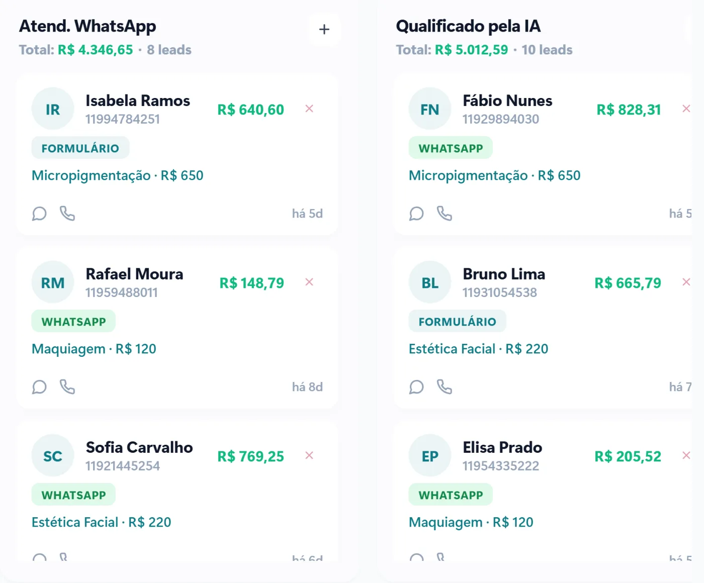

Quase toda empresa começa pelo aplicativo WhatsApp Business, e faz sentido: é gratuito e resolve bem quando o volume é pequeno. Mas chega um momento em que o celular da recepção vira gargalo. É aí que entra a API oficial do WhatsApp Business.

Veja a diferença entre os dois e os sinais de que chegou a hora de mudar.

## O aplicativo WhatsApp Business

É o aplicativo que você baixa no celular, feito para pequenas empresas. Ele oferece:

- perfil da empresa, com endereço, horário e catálogo;
- mensagem de saudação, mensagem de ausência e respostas rápidas;
- etiquetas para organizar as conversas;
- uso em poucos aparelhos ao mesmo tempo.

**Limites:** a conversa fica presa a poucos aparelhos, não há como ligar o WhatsApp a um CRM ou a uma agenda de verdade, a automação é básica e o histórico depende do celular.

## A API oficial do WhatsApp Business

É o acesso oficial da Meta para empresas usarem o WhatsApp dentro de um sistema. Não é um aplicativo: as conversas aparecem no sistema da empresa, que pode ter vários atendentes ao mesmo tempo. Ela permite:

- **vários atendentes no mesmo número**, cada um com o seu acesso;
- **atendimento automático com inteligência artificial** e fluxos com botões;
- **integração** com CRM, agenda, cobrança e o restante do sistema;
- **lembretes e avisos** com modelos de mensagem aprovados pela Meta;
- **histórico guardado no sistema**, e não no celular de alguém.

## E os custos?

O aplicativo é gratuito. Na API oficial, a Meta cobra por mensagem, conforme o tipo: marketing, utilidade (como lembretes e avisos) e autenticação. Desde 1º de outubro de 2026, as respostas de atendimento dentro da janela de 24 horas, que antes eram gratuitas, voltaram a ser cobradas: cada número tem 1.000 mensagens de atendimento grátis por mês e paga a partir da 1.001ª. As mensagens de utilidade enviadas dentro da janela também passaram a ser cobradas. As conversas que começam por um anúncio de clique para o WhatsApp continuam gratuitas enquanto a janela desse anúncio está aberta. Os valores por país estão na [página de preços da Meta](https://developers.facebook.com/documentation/business-messaging/whatsapp/pricing). Além disso, há o custo do sistema que usa a API.

[[cta]]

## Sinais de que chegou a hora de mudar

1. **Mais de uma pessoa precisa atender** o mesmo número.
2. **Mensagens ficam sem resposta** fora do horário ou nos picos de movimento.
3. **Você não sabe quantos contatos viraram clientes**, porque nada fica registrado.
4. **Você precisa de lembretes automáticos**, como confirmação de consulta ou aviso de pagamento.
5. **A conversa depende de um celular**, e quando a pessoa sai da empresa o histórico vai junto.

Se dois ou mais desses sinais aparecem no seu dia a dia, a API oficial já se paga em tempo e em vendas que deixam de escapar.

## Cuidado com as ferramentas não oficiais

Extensões de navegador e aplicativos que prometem automatizar o WhatsApp sem a API oficial violam os termos do WhatsApp e podem levar ao bloqueio do número, com todo o histórico. A economia não compensa o risco.

## Perguntas frequentes

### Posso usar o mesmo número que já tenho no aplicativo?

Sim, o número que a empresa já usa pode ser levado para a API oficial. As condições e o passo a passo são verificados no diagnóstico, para não interromper o atendimento.

### A API oficial tem limite de mensagens?

Para conversas iniciadas pelo cliente, não há limite prático. Para mensagens de modelo enviadas pela empresa, a Meta define limites que aumentam conforme a qualidade e o volume do número.

### Preciso de um programador para usar a API?

Não diretamente. A API é usada por meio de um sistema, como o da VCA, que cuida da conexão, dos atendentes, das automações e das integrações.

### Os clientes percebem alguma diferença?

Eles continuam falando com o mesmo WhatsApp. A diferença é que passam a receber respostas mais rápidas, botões para escolher opções e lembretes no momento certo.
